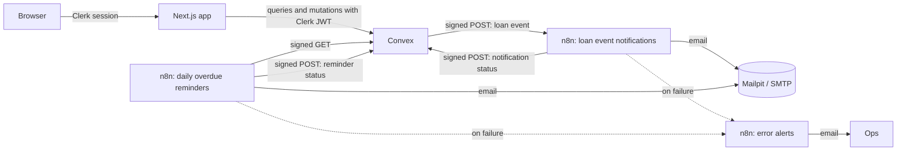

# LendLoop

A tool-lending board for neighbours. People list tools they're willing to lend, ask to borrow each other's tools for a date range, and n8n sends the emails: request updates as they happen, and a daily reminder for anything overdue.

Built with Next.js 16 (App Router), Clerk, Convex, n8n and TypeScript.

- [Running it locally](#running-it-locally)
- [Environment variables](#environment-variables)
- [Architecture](#architecture)
- [Roles and access control](#roles-and-access-control)
- [Security and data minimisation](#security-and-data-minimisation)
- [Reliability and error handling](#reliability-and-error-handling)
- [Tests](#tests)
- [What I'd change for production](#what-id-change-for-production)

## Running it locally

You need Node 22, Docker, a Convex account and a Clerk application.

**1. Install and start Convex**

```bash
npm install
npx convex dev          # creates the deployment and writes .env.local
```

Leave it running. To run the backend on your machine instead of in the cloud, use `npx convex dev --dev-deployment local`.

**2. Connect Clerk**

In the Clerk dashboard, open Integrations → Convex and activate it. That creates the `convex` JWT template the app asks for. Then:

```bash
cp .env.example .env.local       # keep the Convex lines convex dev wrote
# add NEXT_PUBLIC_CLERK_PUBLISHABLE_KEY and CLERK_SECRET_KEY
npx convex env set CLERK_JWT_ISSUER_DOMAIN https://<your-app>.clerk.accounts.dev
```

**3. Start n8n and Mailpit**

```bash
cp n8n/.env.example n8n/.env
openssl rand -hex 32    # run three times: encryption key and the two secrets
docker compose up -d
```

Put the same two secrets into Convex, plus the webhook URL:

```bash
npx convex env set N8N_WEBHOOK_SECRET <same as n8n/.env>
npx convex env set CONVEX_WEBHOOK_SECRET <same as n8n/.env>
npx convex env set N8N_LOAN_EVENTS_WEBHOOK_URL http://localhost:5678/webhook/lendloop-loan-events
```

`docker compose up` imports the three workflows and an SMTP credential that points at Mailpit, then publishes them. n8n runs on http://localhost:5678 and every email it sends shows up in Mailpit at http://localhost:8025.

A cloud Convex deployment can't reach `localhost:5678`. For that setup, expose n8n with a tunnel (`cloudflared tunnel --url http://localhost:5678`) and use the tunnel URL, or use n8n Cloud. Going the other way, set `CONVEX_SITE_URL` in `n8n/.env` to your `https://<deployment>.convex.site` URL. The local backend is reachable from the container at `http://host.docker.internal:3211`, which is the default.

**4. Run the app**

```bash
npm run dev                       # http://localhost:3000
npx convex run seed:demo          # optional: demo neighbours, tools and an overdue loan
```

Sign in once, then make yourself an admin from the CLI:

```bash
npx convex run users:setRole '{"email": "you@example.com", "role": "admin"}'
```

To fire the overdue reminder without waiting for 09:00, open the "LendLoop: daily overdue reminders" workflow in n8n and run it manually. The seeded tent loan is two days overdue, so Priya gets an email.

## Environment variables

| Where        | Name                                                            | What it's for                                                                                             |
| ------------ | --------------------------------------------------------------- | --------------------------------------------------------------------------------------------------------- |
| `.env.local` | `NEXT_PUBLIC_CONVEX_URL`, `CONVEX_DEPLOYMENT`                   | Written by `npx convex dev`                                                                               |
| `.env.local` | `NEXT_PUBLIC_CLERK_PUBLISHABLE_KEY`, `CLERK_SECRET_KEY`         | Clerk keys                                                                                                |
| Convex       | `CLERK_JWT_ISSUER_DOMAIN`                                       | Clerk Frontend API URL, used to verify session tokens                                                     |
| Convex       | `N8N_LOAN_EVENTS_WEBHOOK_URL`                                   | Production URL of the loan-event webhook. If unset, events are marked `skipped` and the app keeps working |
| Convex       | `N8N_WEBHOOK_SECRET`                                            | Signs Convex → n8n requests                                                                               |
| Convex       | `CONVEX_WEBHOOK_SECRET`                                         | Verifies n8n → Convex requests                                                                            |
| `n8n/.env`   | `N8N_ENCRYPTION_KEY`                                            | Encrypts stored n8n credentials                                                                           |
| `n8n/.env`   | `N8N_WEBHOOK_SECRET`, `CONVEX_WEBHOOK_SECRET`                   | Same values as in Convex                                                                                  |
| `n8n/.env`   | `CONVEX_SITE_URL`                                               | Base URL of the Convex HTTP actions                                                                       |
| `n8n/.env`   | `LENDLOOP_APP_URL`, `LENDLOOP_FROM_EMAIL`, `LENDLOOP_OPS_EMAIL` | Links in emails, sender, and where failure alerts go                                                      |

There are no secrets in the repo. The workflow JSON reads everything through `$env`, and the SMTP credential is stored encrypted by n8n. The seeded Mailpit credential has no password because Mailpit doesn't use one.

## Architecture



**Next.js** is a thin client. Pages are static shells, and data comes from Convex through reactive `useQuery` hooks, so a request approved in one tab updates the borrower's view straight away. `src/proxy.ts` sends signed-out visitors away from the board pages, but that's only a convenience. Every rule is enforced again in Convex.

**Convex** holds the data and all the business rules.

| Table               | Holds                                                                                                                   |
| ------------------- | ----------------------------------------------------------------------------------------------------------------------- |
| `users`             | Clerk token id, first name, email, role, trusted-lender flag                                                            |
| `tools`             | Listing fields and owner. Removal is a soft delete so loan history keeps its tool name                                  |
| `loans`             | One row per borrow request. Status goes `pending` → `approved` / `declined` / `cancelled`, then `approved` → `returned` |
| `webhookDeliveries` | Outbox for calls to n8n: event type, loan, recipient, attempts, last error                                              |
| `automationEvents`  | What n8n reported back, keyed by an idempotency key. Shown on each loan as "Reminder sent 2 days ago"                   |

Availability isn't stored. It's worked out from approved loans and today's date: a tool is "on loan" once an approved loan has started, and overdue once its end date has passed. Approving a request that overlaps another approved loan is refused.

**Loan events.** Each mutation that changes a loan writes an outbox row and schedules `notifications.deliver` in the same transaction. If the mutation rolls back, no notification goes out. The action builds the payload at send time, signs it and posts it to n8n. The workflow checks the signature against the raw request body, answers `202` right away, emails the right person, and posts the result back to `/n8n/automation-events`.

**Overdue reminders.** n8n runs daily at 09:00, calls `GET /n8n/overdue-loans` with a signed request, splits the result into one item per loan, emails each borrower, and posts each result back. Convex returns an idempotency key with each loan (`overdue:<loanId>:<date>`) so n8n doesn't have to invent one.

Code layout:

```
convex/
  schema.ts            tables and indexes
  lib/functions.ts     userQuery / userMutation / adminQuery / adminMutation
  lib/signature.ts     HMAC signing and verification
  tools.ts loans.ts admin.ts users.ts
  notifications.ts     outbox delivery with retries
  automation.ts http.ts  endpoints n8n calls
  model/loans.ts       shared loan rules (availability, outbox, cancellation)
src/
  app/                 landing page and the (board) route group
  components/          UI, one file per view
n8n/workflows/         exported workflows, imported on `docker compose up`
```

## Roles and access control

| Role  | Can do                                                                                                                                                                                   |
| ----- | ---------------------------------------------------------------------------------------------------------------------------------------------------------------------------------------- |
| user  | Create, edit and remove their own listings. Ask to borrow other people's tools and cancel their own pending requests. Approve, decline and mark returned on requests for their own tools |
| admin | Everything a user can, plus remove any listing, see every loan, mark or unmark a Trusted Lender, and see webhook deliveries that failed                                                  |

Checks live in Convex, not in the UI:

- Every signed-in function is built with `userQuery`, `userMutation`, `adminQuery` or `adminMutation` from `convex/lib/functions.ts`. These look up the caller from the verified Clerk token before the handler runs, so a handler can't forget to.
- Ownership is checked against the database row, never against an id the client sends. Approving a loan compares `loan.ownerId` with the caller, for example.
- An admin can remove any listing but can't approve, decline or edit on someone else's behalf. Those stay with the owner.
- Only the owner can mark a loan returned. They're the one who knows the tool came back.
- Roles are set with an internal mutation (`users:setRole`) that can only be run from the Convex CLI or dashboard. No client-callable function changes a role.
- Functions n8n uses are `internal*` and only reachable through the signed HTTP endpoints.

The test suite checks these rules by calling each function as the wrong user.

## Security and data minimisation

**Signed webhooks in both directions.** Requests carry `x-lendloop-timestamp` and `x-lendloop-signature: v1=<hex>`, where the signature is HMAC-SHA256 over `<timestamp>.<raw body>`. The receiver:

- recomputes it over the raw bytes, not re-serialised JSON
- compares in constant time
- rejects timestamps more than five minutes off, which limits replays

Each direction has its own secret, so a leak on one side doesn't let someone forge the other. n8n's Code nodes use `node:crypto` and Convex uses Web Crypto. A unit test checks that both produce the same signature.

**What leaves Convex.** The loan-event payload has the recipient's first name and email, the tool name, the dates and opaque ids. It never includes the other party's details, so the owner's email isn't sent when the borrower is notified, and the reverse. Message text is written in n8n and points back to the app for details. `GET /n8n/overdue-loans` returns the same kind of minimal record. The public landing page only gets tool name and category: no owner, no description, no availability dates.

**What's stored.** Only a first name and email per user, both from Clerk. Clerk keeps the rest of the profile. Admin views show first names, not emails. The outbox stores ids, not payloads, so personal data isn't copied into it. n8n execution data is pruned after seven days (`EXECUTIONS_DATA_MAX_AGE=168`).

**Input handling.** Lengths and date ranges are validated in Convex. Categories and conditions are enums in the schema. The HTTP endpoints cap the body at 4 KB and check its shape with a validator before touching the database. Error messages to the client are plain `ConvexError` strings, and internal errors aren't passed through.

**Abuse limits.** A borrower can have at most ten pending requests and one per tool. Loans are capped at 30 days.

## Reliability and error handling

Convex → n8n:

- The outbox row is written in the same transaction as the loan change, so an event can't be lost between the two.
- `deliver` retries network errors, 5xx, 408 and 429 with backoff (30 s, 2 min, 10 min, 30 min) for up to five attempts, then marks the row `failed` and logs it. Other 4xx responses, such as a bad signature, fail straight away because retrying the same bytes won't help.
- Failed deliveries are listed on the admin page.
- With no n8n configured, events are marked `skipped` instead of failing.

n8n → Convex:

- HTTP and email nodes retry three times before failing.
- A failed email doesn't stop the run. It goes down the error branch and is written back as `failed`, so the loan shows "Reminder failed" instead of nothing.
- If a run fails anyway, for example because Convex is down past the retries, both workflows hand off to "LendLoop: error alerts", which emails ops with the workflow, node, error and a link to the execution.
- Write-backs are idempotent. Convex keys each record by `notify:<deliveryId>` or `overdue:<loanId>:<date>`. A repeat with the same key returns `duplicate` and writes nothing, and a later `sent` can replace an earlier `failed` but not the reverse. The overdue endpoint also leaves out loans already reminded that day, so a rerun of the daily job doesn't email anyone twice.

Delivery to n8n is at least once. If n8n accepted an event but the `202` never reached Convex, the email could go out twice. The write-back would still only be recorded once.

I checked these paths against a real n8n 2.45 instance: a signed event produced an email in Mailpit and a `sent` record in Convex, unsigned and forged requests got `401` from both sides, a second overdue run sent nothing, and a write-back for an unknown loan retried, failed, and produced an ops alert.

## Tests

```bash
npm test             # Convex functions, with convex-test
npm run typecheck    # Next.js and Convex
npm run lint
```

The 50 tests cover access rules for every role, the loan lifecycle and date validation, signature verification including tampering and replay, the HTTP endpoints including idempotent write-backs, and outbox delivery including retry, give-up and skip cases. There are no automated UI tests yet. I went through the main flows by hand with two accounts: list, request, approve, return, the admin panel, and the emails in Mailpit.

## What I'd change for production

- **Hosting.** Convex production deployment, the Next.js app on Vercel, and n8n either on n8n Cloud or self-hosted with Postgres, queue mode and external task runners (internal mode is deprecated). Put n8n behind TLS and keep its editor off the public internet, exposing only the webhook path.
- **Secrets.** Keep them in a secret manager and rotate them on a schedule. Verification would accept the current and previous secret for a short window so a rotation doesn't drop events. The `v1=` prefix leaves room to change the algorithm later.
- **Email.** Replace Mailpit with a real provider (SES, Postmark) holding its key in an n8n credential. Add unsubscribe handling and a per-user notification setting.
- **Clerk webhooks.** Sync users and deletions through Clerk's webhook instead of on sign-in, so deleting an account removes the Convex row and cancels open requests.
- **Scale.** Listing queries read up to 200 rows and work out availability per tool. Past a few thousand tools I'd paginate the board, store an availability field updated by the loan mutations, and paginate `/n8n/overdue-loans`.
- **Observability.** Send Convex logs and n8n error alerts to Sentry or Datadog rather than email, and alert on the count of `failed` deliveries.
- **Handover.** Once a loan is approved, the two neighbours still have to arrange pickup outside the app. I'd add short per-loan messages instead of revealing email addresses to each other.
- **Abuse.** Rate-limit mutations per user (`@convex-dev/rate-limiter`) and add a way to report a listing.
- **Tests.** Playwright runs through the main flows against a preview deployment, and a CI job that runs lint, typecheck and tests on every PR.
